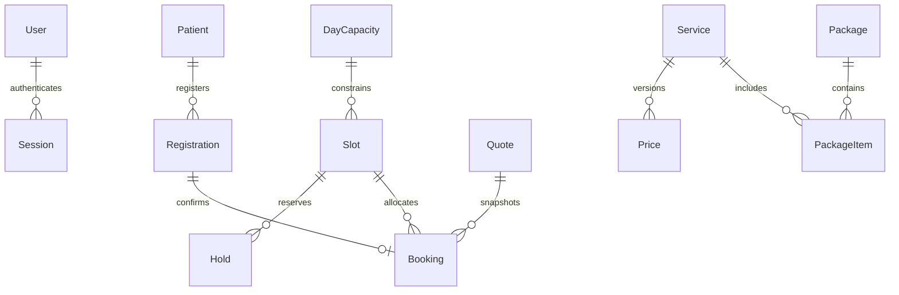

# Database model

Additional tables: RateLimit, Verification, Questionnaire, ImportBatch, Organization, Invoice, PrivacyRecord, PrivacyRequest, Notification and Audit. Session IDs in audit/ownership domains are opaque identifiers. Retention purge must be approved before deleting evidence. All Prisma DateTime fields are UTC DATETIME(3); UI uses Asia/Bangkok and Thai Buddhist date formatting. MySQL tables use InnoDB, utf8mb4 and foreign keys generated in the migration. Use DECIMAL(12,2) for money; JS business arithmetic uses Decimal.js.

Financial references in Invoice and import/approval actor IDs are currently logical references; these require further normalization/foreign keys before the full enterprise gate. Roles are a deny-by-default code matrix rather than configurable permission tables. The schema is not presented as covering every proposed logical table in the master prompt.
